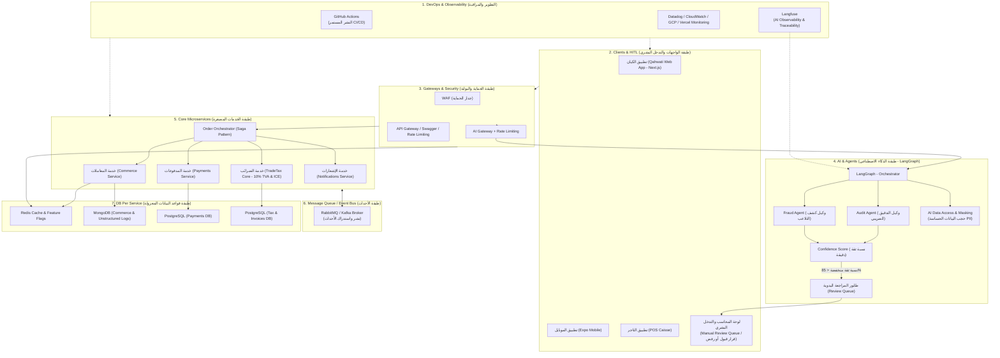

# المعمارية المعتمدة لمنظومة قهوتي (Qahwati Enterprise Architecture Blueprint)

> **وثيقة المعمارية الرسمية الملزمة:** هذا التصميم يمثل البنية التحتية الأساسية والمعتمدة للمشروع، ويجب عدم الخروج عن هذا المخطط الهيكلي.

---

## 1. المخطط العام للمنظومة (Master System Diagram)

---

## 2. تفصيل الطبقات السبع للمنظومة (Detailed Layers Breakdown)

### الطبقة الأولى: Clients & HITL (الواجهات وتطبيقات المستخدمين)
* **Qahwati App (الويب والموبايل)**: واجهة الزبائن لاكتشاف المقاهي المستقلة، استعراض المنيو، الطلب، والدفع.
* **POS التاجر**: كاشير سريع وشاشة تحضير الباريستا والمطبخ وتتبع الطلبات اللحظية.
* **لوحة المحاسب (Human-in-the-Loop)**: فحص طابور المراجعة اليدوية للطلبات المشبوهة أو التي تتطلب موافقة بشرية، بالإضافة للدفاتر المحاسبية.
* **بوابة المراقبة الجبائية (DGI)**: واجهة التدقيق الضريبي الرقمي عن بعد.

### الطبقة الثانية: Gateways & Security (البوابة والحماية)
* **جدار الحماية WAF**: التصدي لهجمات DDoS وحقن SQL و XSS.
* **API Gateway & Swagger**: توجيه المسارات، توثيق OpenAPI، وتحديد وتيرة الطلبات (Rate Limiting).
* **AI Gateway**: ضبط الوصول لوكلاء الذكاء الاصطناعي مع قياس الحصص والتكلفة.

### الطبقة الثالثة: AI & Agents (ميدان الذكاء الاصطناعي والتدقيق)
* **LangGraph Orchestrator**: منسق دورات الوكلاء الذكية.
* **Audit Agent (وكيل التدقيق)**: التحقق التلقائي من صحة حسابات الضريبة (10% TVA)، ومطابقة رقم الـ ICE.
* **Fraud Agent (وكيل مكافحة الاحتيال)**: رصد العمليات غير المعتادة والشذوذ في أحجام المبيعات وسرعة المعاملات.
* **AI Data Access & Masking**: تشفير وإخفاء أرقام الهواتف والبطاقات قبل إرسالها لوكلاء الذكاء الاصطناعي.
* **Confidence Score**: إذا كانت نسبة الثقة ≥ 85% يتم قبول المعاملة وتوثيقها؛ وإذا قلت، تحول تلقائياً لطابور المراجعة اليدوية للمحاسب (HITL).
* **Langfuse Observability**: تسجيل كل خطوة واستجابة للذكاء الاصطناعي لضمان عدم وجود هلوسة أو أخطاء.

### الطبقة الرابعة: Microservices (الخدمات المصغرة الأساسية)
* **Order Orchestrator (Saga Pattern)**: إدارة دورة حياة الطلب عبر المعاملات التعويضية لضمان الاتساق (Data Consistency).
* **Commerce Service**: إدارة قوائم المقاهي، الأسعار، والسلات.
* **Payments Service**: إدارة المعاملات النقدية، بطاقات CMI، والتسوية.
* **TradeTax Core (الضرائب والفوترة)**: تطبيق الفوترة القانونية المغربية، التسلسل الرقمي بدون انقطاع، والـ ICE.
* **Notifications Service**: إرسال الإشعارات للزبائن والباريستا.

### الطبقة الخامسة: Message Queue (طابور الرسائل والأحداث)
* وسيط الرسائل (RabbitMQ / Apache Kafka) للاتصال غير المتزامن (Asynchronous Event-Driven).
* المواضيع (Topics): `order.created`, `payment.processed`, `invoice.issued`, `ai.fraud_detected`.

### الطبقة السادسة: DB Per Service (عزل قواعد البيانات)
* **Redis**: التخزين المؤقت، الجلسات السريعة، وإدارة أعلام الميزات (Feature Flags).
* **MongoDB**: تخزين البيانات غير المهيكلة، سجلات التصفح، والكتالوجات المرنة.
* **PostgreSQL (Payments DB)**: المعاملات المالية، جلسات الصندوق، والتسويات المصرفية.
* **PostgreSQL (Tax DB)**: الفواتير القانونية، السجل اللامتغير، وحسابات الـ TVA.

### الطبقة السابعة: DevOps & Observability (التطوير والمراقبة)
* **GitHub Actions**: خط أنابيب النشر المستمر (CI/CD) للفحص الآلي والدمج.
* **Vercel & Cloud Monitoring**: متابعة الأداء ومؤشرات وقت الاستجابة (Latency).
* **Langfuse**: منصة تتبع ومراقبة استجابات الذكاء الاصطناعي وضمان الموثوقية.

---

> **قاعدة التطوير الصارمة:** أي ميزة أو شاشة جديدة يجب أن ترتبط مباشرة بالخدمات والطبقات المحددة في هذا المخطط المعماري دون الخروج عنه.
